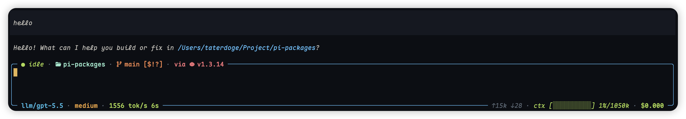
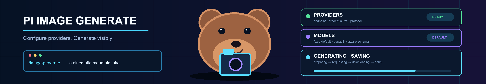
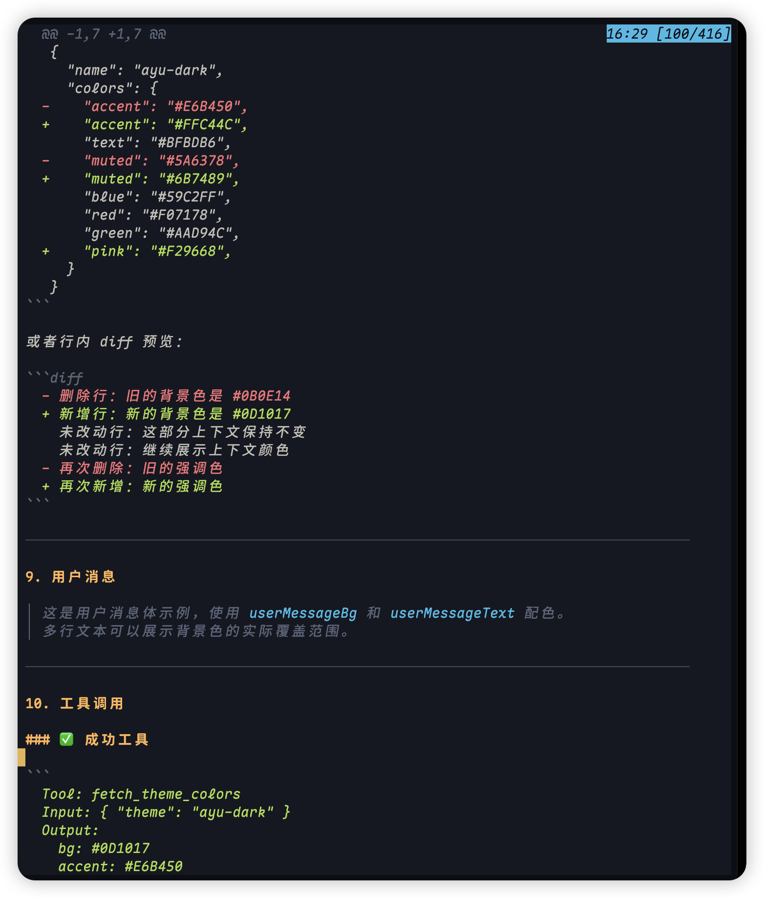
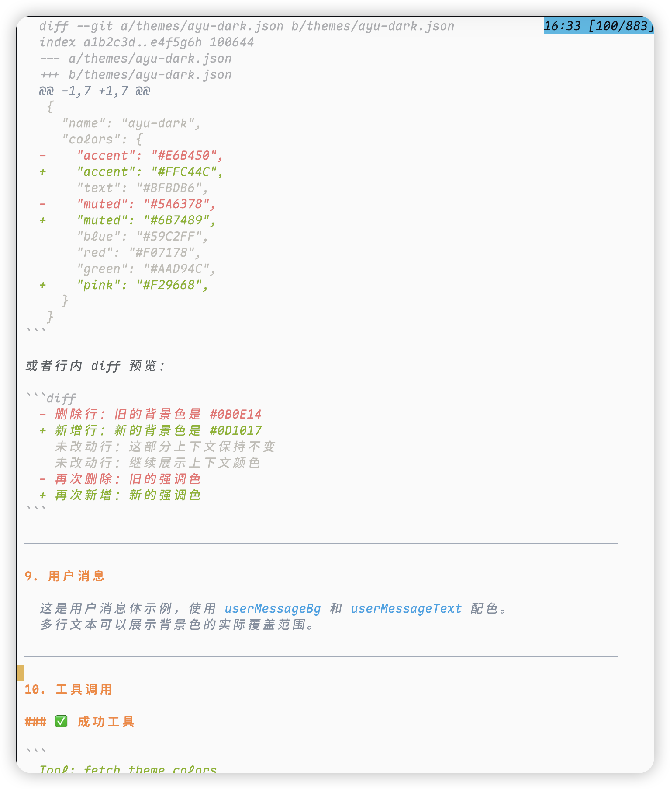

# 🎨 Pi Packages

[](https://www.npmjs.com/org/taterdoge) [](./LICENSE)

Theme and extension packages for the [Pi](https://pi.dev) coding agent. This Bun workspaces monorepo provides independently installable Pi packages for Ayu color themes, status bars, and more.

## 📦 Pi packages

Install only the packages you need. Each package is published under the `@taterdoge` npm scope and can be installed directly with `pi install npm:<package>`.

| Pi package | What it adds | Install |
| --- | --- | --- |
| [`@taterdoge/pi-ayu`](./apps/pi-ayu) | 🎨 Ayu-inspired dark and light color themes for the Pi terminal UI. | `pi install npm:@taterdoge/pi-ayu` |
| [`@taterdoge/pi-status`](./apps/pi-status) | 📊 Configurable live status bar as border decorations around the Editor. | `pi install npm:@taterdoge/pi-status` |
| [`@taterdoge/pi-image-generate`](./apps/pi-image-generate) | 🖼️ Skill-driven image generation with configurable providers, models, protocols, live status, and browser settings. | `pi install npm:@taterdoge/pi-image-generate` |
| [`@taterdoge/pi-remember-model`](./apps/pi-remember-model) | 🧠 Remembers the model per directory and each model's thinking level. | `pi install npm:@taterdoge/pi-remember-model` |

## 🚀 Quick start

Install a package from npm:

```bash
pi install npm:@taterdoge/pi-ayu
```

Try a package once without adding it permanently:

```bash
pi -e npm:@taterdoge/pi-ayu
```

Then select a theme via `/settings`.

## 🛠️ Package highlights

### 📊 Pi Status

Use [`@taterdoge/pi-status`](./apps/pi-status) to add a live status bar as border decorations around the Editor. Four configurable zones (top-left, top-right, bottom-left, bottom-right) show real-time segments for activity state, cwd, turn, active tool, git branch, runtime, model, thinking level, TPS, tokens, context window, and cost — all arranged in a browser layout editor opened by `/pi-status` (drag modules between zones, set the separator and context bar preset, save and it applies live).



### 🖼️ Pi Image Generate

Use [`@taterdoge/pi-image-generate`](./apps/pi-image-generate) for skill-driven image generation and editing. Configure your own OpenAI Images-compatible, Gemini-compatible, or generic JSON provider/model in the local browser page opened by `/image-generate settings`, then follow every generation phase in Pi's status area.



### 🧠 Pi Remember Model

Use [`@taterdoge/pi-remember-model`](./apps/pi-remember-model) to keep a per-directory model record in `extensions/pi-remember-model/models.json`, so `/repo/a` and `/repo/b` stop overwriting each other's model. An explicit `--model` (how `pi-subagents` pins a child agent to its own model) still wins over the record. Thinking levels are stored in Pi's own `modelThinkingLevels`, so a level one model cannot support never leaks into another model.

### 🎨 Ayu themes

Use [`@taterdoge/pi-ayu`](./apps/pi-ayu) to bring the popular Ayu color scheme to your Pi terminal. Includes both `ayu-dark` (low-contrast dark surface with amber, blue, green, and coral accents) and `ayu-light` variants.

| ayu-dark                                        | ayu-light                                         |
| :---------------------------------------------: | :-----------------------------------------------: |
|  |  |

## 🧑‍💻 Local development

Install dependencies from the repository root:

```bash
bun install
```

Run the full repository check:

```bash
bun run check
```

Try a package locally:

```bash
pi -e ./apps/pi-ayu
```

Or install from a local package path:

```bash
pi install ./apps/pi-ayu
```

Preview npm package contents before publishing:

```bash
npm pack --workspace @taterdoge/pi-ayu
```

## 🚀 Release

Versioning and publishing are automated by [`.github/workflows/release.yml`](./.github/workflows/release.yml): on every push to `main` it runs `bun run check`, then either opens a `chore: version packages` PR or publishes whatever that PR merged.

So the only hand-written part is the changeset. Add one to any PR that changes behavior:

```bash
bun run changeset      # pick patch/minor/major and describe the change
```

- `bun run version` (run by CI) folds pending changesets into each `package.json` version and `CHANGELOG.md`
- `bun run release` (run by CI) publishes the bumped packages to npm; locally it needs npm auth, in CI the `NPM_TOKEN` secret
- A package that is already installed from npm picks a release up with `pi update npm:@taterdoge/<package>`

Write the changeset in the language and voice the package's existing `CHANGELOG.md` already uses — that text ships to users.

## 🗂️ Repository structure

```txt
apps/                 # Pi packages — what users install
├── pi-ayu/             # Theme JSON files
│   ├── assets/
│   └── themes/
├── pi-image-generate/  # Extension source + own browser page
│   ├── assets/
│   ├── skills/         # Image generation skill
│   ├── src/            # Extension source (TS)
│   ├── test/           # Bun tests
│   └── web/            # Its React page + built assets
├── pi-remember-model/
│   ├── src/            # TUI extension source (TS)
│   └── test/
├── pi-status/          # Extension source + own browser layout editor
│   ├── assets/
│   ├── src/            # Extension source (TS)
│   ├── test/
│   └── web/            # Its React page + built assets
│
├── README.md / LICENSE / package.json in every app

docs/                 # Design notes, e.g. browser-ui-architecture.md

packages/             # Shared libraries only — never installed on their own
└── ui/                 # shadcn/ui base-nova components, theme, Tailwind tokens
```

`apps/` holds installable Pi packages; `packages/` holds code other packages import. Each app owns its whole presentation layer, including any browser page and its server — a shared settings abstraction would cap what each extension can grow into, so only genuinely duplicated shadcn components live in `packages/`. See [`docs/browser-ui-architecture.md`](./docs/browser-ui-architecture.md) for why the shared settings DSL was dropped and what each extension still must implement itself (one-time token, masked secrets, loopback binding, idle shutdown, CSP).

Each package contains its own `package.json`, `README.md`, `LICENSE`, and source assets. The root workspace handles shared linting, type-checking, web builds, and publishing scripts. `web/dist` is a build artifact and is not committed — `bun run check` builds it before publishing.

## ➕ Add a new package

1. Copy an existing package (e.g. `apps/pi-ayu`) to `apps/pi-your-package`
2. Rename the package, entry points, and tool names
3. If it has a `web/` page, add `-p apps/pi-your-package` to the root `typecheck` script — the root `tsc` only covers `*.ts`, so `.tsx` otherwise ships unchecked
4. Run `bun run check`

## 📄 License

MIT. See [`LICENSE`](./LICENSE).
